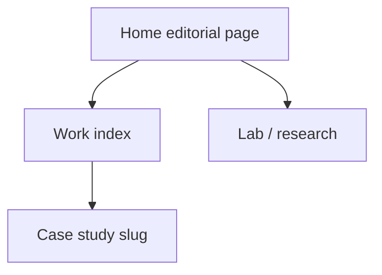

# Portfolio revamp: editorial systems engineer

**Short answer on Next.js:** You do **not** need Next.js for a distinctive look. You **do** get real engineering advantages from it *because you already have Vercel + Cloudflare*. Staying on GitHub Pages would throw most of those advantages away. Decision: **Next.js App Router, Vercel as the app host, Cloudflare as DNS/CDN, retire GitHub Pages as the live origin.**

---

## 1. Current audit

The live site ([snehinadepu.me](https://www.snehinadepu.me)) is a **single ~114KB [index.html](index.html)** with inline CSS/JS. Vite is only a bundler. [package.json](package.json) has **no React, Tailwind, or Three.js npm deps**. `tsconfig` already expects React JSX; [src/index.css](src/index.css) has unused Tailwind directives.

**What works (keep):**
- Custom domain, SEO/JSON-LD, sitemap, OG tags, favicons, `robots.txt`
- **57-frame hero sequence** in `public/frames/` (scroll-scrubbed images, not video)
- Profile photo, verified copy (Eli Lilly, Loomylabs, Alfago, research links)
- GitHub Actions build pattern (will retarget to Vercel, not Pages)

**What reads as generic AI-template (replace):**
- Navy + gold + electric blue, glass navbar, floating particles, wireframe “neural globe”
- Repeated rounded cards, pill skill tags, “Technical Arsenal”, “Architecting the Future”, “Let’s Build Together”
- Three.js **r128 CDN**, always-on `requestAnimationFrame`, no `prefers-reduced-motion`
- LinkedIn/YouTube iframes duplicated for infinite scroll (privacy + performance)
- No résumé link, no real project visuals (icons instead of screenshots), no case-study URLs

**Facts to present carefully (do not inflate):**
- Loomylabs: 70%+ inference cost cut, GCP CI/CD, PostgreSQL/Supabase, 1,000+ concurrent users, Vertex AI benchmarking
- Alfago: OHLCV every 5 min, 50,000+ records/day, S3 + Parquet, time-series aggregation
- JanSamadhan demo: `https://crm-five-gold-48.vercel.app/`
- Monument project Sketchfab: `https://skfb.ly/pIrCK`
- Paper: [ResearchGate](https://www.researchgate.net/publication/412146269_Securing_IoT_Networks_Using_Hybrid_Machine_Learning_Model_Against_DDoS_Attacks)
- Book chapter is **conditionally accepted**
- No résumé PDF in the repo (manual add)

---

## 2. Why Next.js here (and what you actually gain)

| Capability | Vanilla Vite (today) | Next.js on Vercel + Cloudflare |
|---|---|---|
| Per-page SEO (`/work/jansamadhan`) | One homepage only | Real HTML + unique titles/OG per case study |
| `next/font` self-hosted | Google Fonts CSS (FOUT, extra origin) | Fonts bundled at build, better LCP/privacy |
| `next/image` | Raw JPGs | Responsive `srcset`, WebP/AVIF, priority LCP |
| OG images | One static `og-image.jpg` | Generated per route if needed |
| R3F | Awkward in a 2.7k-line HTML file | Client components, code-split, lazy Canvas |
| Hosting | GitHub Pages static | Vercel native Next.js; Cloudflare DNS already in play |
| Server features | None | Optional later: contact API, résumé analytics — not required for v1 |

**What Next.js does *not* magically give you:** originality, typography, or recruiter trust. Those come from art direction and evidence.

**What we will not use:** `output: 'export'` (that is the GitHub Pages compromise). Full Next.js on Vercel.

**Cloudflare role:** keep DNS (and WAF if you want). Point the apex/`www` to Vercel. Prefer **DNS-only (grey cloud)** for the Vercel origin so SSL and preview URLs are not double-proxied. Do not keep GitHub Pages deploying the same domain or the two hosts will fight.

**Astro was considered** (best raw JS weight via islands). Rejected for this pass: GSAP ScrollTrigger + R3F + shared page motion is cleaner as one React tree; you already have Vercel.

---

## 3. Three directions (pick one)

**A. Digital laboratory** — diagrams, CAD-like overlays, instrument panels. Risk: looks like every “AI lab” template if not extremely restrained.

**B. Editorial creative technologist** — Swiss/print grids, oversized type, asymmetric case studies, almost no decoration. Highest recruiter usability and originality vs current site.

**C. Immersive computational world** — scroll-driven 3D environment. Memorable, but weakest on mobile/battery, accessibility, and time-to-content.

**Recommended hybrid: B + one motif from C** — “editorial systems engineer.” The page reads like a designed publication. A **single** 3D object (an inference/cost-graph lattice, not a neural globe) lives in the hero. Everything else is type, grid, real artifacts, and GSAP.

---

## 4. Visual system

- **Philosophy:** Warm-ink editorial, not cosmic neon. Character from type, crop, and evidence.
- **Palette:** Warm black `#0C0B09`, bone `#F3EEE6`, muted ink `#8A847A`, **one** copper accent `#C45C26`. No gold/blue pairing, no purple gradients, no glass nav.
- **Type (OFL, free):** [Instrument Serif](https://fonts.google.com/specimen/Instrument+Serif) (display) + [Geist](https://vercel.com/font) (UI/body) + [IBM Plex Mono](https://fonts.google.com/specimen/IBM+Plex+Mono) (labels/code). Loaded via `next/font`.
- **Grid:** 12-column, large margins, asymmetric project spreads (visual 7 / copy 5), mobile stacks.
- **Signature 3D:** Procedural Three.js lattice (no heavy GLB). Pointer tilts it; scroll reduces opacity as the portrait frames take over. CSS/2D fallback = same geometry as SVG.
- **Motion:** GSAP + ScrollTrigger + SplitText only. No Motion/Framer, no Lenis, no scroll hijack. `prefers-reduced-motion`: skip SplitText, freeze frame 1, skip WebGL.
- **Images:** Real screenshots/diagrams for projects; keep portrait frames; convert frames to WebP where quality holds.

---

## 5. Reusable components and resource library

Principle: **copy primitives, not portfolio templates.** Magic UI, Aceternity, and “Awwwards clone” repos are useful as technique references. Dropping their heroes, bento grids, orbiting icons, and spotlight cards onto this site would make it look *more* templated, not less. We restyle every borrowed piece into the copper/bone editorial system.

### A. Use directly (install or paste, then restyle)

| Piece | URL | License | Where it goes | Difficulty | Performance |
|---|---|---|---|---|---|
| Next.js App Router, `next/font`, `next/image`, Metadata | https://nextjs.org/docs | MIT | Whole app | Low | Gains LCP/SEO vs SPA |
| shadcn **Button**, **Sheet/Drawer**, **Tooltip**, **Separator** | https://ui.shadcn.com/docs/components · https://github.com/shadcn-ui/ui | MIT (keep license comments in copied files) | Nav CTAs, mobile menu, icon labels | Low | Tiny; Radix/Vaul under the hood |
| Vaul drawer | https://vaul.emilkowal.ski · https://github.com/emilkowalski/vaul | MIT | Mobile nav instead of a hamburger overlay | Low | CSS transform, fine on mobile |
| Embla Carousel (via shadcn Carousel or `embla-carousel-react`) | https://www.embla-carousel.com · https://ui.shadcn.com/docs/components/carousel | MIT | Media strip (YouTube posters, not 10 iframes) | Low | Lazy slides; no autoplay loop of iframes |
| Lucide icons | https://lucide.dev | ISC | Sparse UI icons only | Low | Tree-shake |
| GSAP core + ScrollTrigger + SplitText + ScrollTo + Flip | https://gsap.com/docs/v3/Plugins/ScrollTrigger/ · https://gsap.com/docs/v3/Plugins/SplitText/ · https://gsap.com/resources/React · React starters: https://stackblitz.com/@gsap-dev/collections/gsap-react-starters | Standard License, free commercial (Apr 2025): https://gsap.com/community/standard-license/ | Line reveals, project pin, résumé scroll, optional Flip on case-study expand | Medium | Pause offscreen; skip if `prefers-reduced-motion` |
| `@gsap/react` `useGSAP` | https://github.com/greensock/react | same GSAP license | All GSAP in React (auto cleanup) | Low | Prevents leak/tweens on unmount |
| React Three Fiber | https://r3f.docs.pmnd.rs/ | MIT | Hero lattice only | Medium | Code-split, `ssr: false` |
| Drei `AdaptiveDpr`, `PerformanceMonitor`, `Preload`, `Line`/`Segments`, `Html` | https://github.com/pmndrs/drei · View (optional later): https://drei.docs.pmnd.rs/portals/view | MIT | Lattice geometry + GPU throttle | Medium | Cap DPR 1–1.5; `frameloop="demand"` when idle |
| Drei `Environment` studio/city preset | https://drei.docs.pmnd.rs/staging/environment | MIT; HDRIs typically Poly Haven **CC0** https://polyhaven.com/license | Soft lighting on lattice | Low | One small HDR; skip on mobile |
| Instrument Serif | https://fonts.google.com/specimen/Instrument+Serif | SIL OFL | Display headlines | Low | Self-host via `next/font` |
| Geist | https://vercel.com/font · https://github.com/vercel/geist-font | SIL OFL | Body/UI | Low | Self-host |
| IBM Plex Mono | https://fonts.google.com/specimen/IBM+Plex+Mono | SIL OFL | Labels, slugs, meta | Low | Self-host |
| YouTube poster + click-to-play | Thumbnails: `https://i.ytimg.com/vi/VIDEO_ID/hqdefault.jpg` · Embed (privacy): https://support.google.com/youtube/answer/171780 (`youtube-nocookie.com`) | YouTube ToS; **host a local copy of the poster** for production | Media row | Low | Zero iframe until click |
| Sketchfab model (existing demo) | https://skfb.ly/pIrCK | Sketchfab embed ToS; prefer screenshot + outbound link | Monument case study | Low | Screenshot > live embed |

**GSAP patterns to implement ourselves (few dozen lines, not a UI kit):**
- SplitText line mask reveal (`type: "lines", mask: "lines"`, `autoSplit: true`) — https://gsap.com/docs/v3/Plugins/SplitText/
- Magnetic button via `gsap.quickTo` on x/y (same idea as https://motion-primitives.com/docs/magnetic, but **no Motion dependency**)
- DrawSVG on an SVG lattice fallback — https://gsap.com/docs/v3/Plugins/DrawSVGPlugin/
- ScrollTrigger scrub of the existing 57-frame sequence (replace the raw `scroll` listeners)

### B. Copy the idea, not the default look

These are copy-paste kits. We may steal **one** interaction and restyle it. We will **not** install the full library or clone their templates.

| Source | URL | License | Useful bit | Why not wholesale |
|---|---|---|---|---|
| Magic UI Marquee | https://magicui.design/docs/components/marquee · MIT https://github.com/magicuidesign/magicui | CSS infinite strip for capabilities or media labels | Built on Motion; default look is on thousands of landing pages |
| Magic UI Text Animate | https://magicui.design/docs/components/text-animate | MIT | Word/line split API | Overlaps GSAP SplitText; would add Motion |
| Magic UI Number Ticker | https://magicui.design/docs/components/number-ticker | MIT | Count-up | Plan avoids metric-as-decoration; if used, only for verified 70% / 8.55 with visible context |
| motion-primitives Magnetic / Tilt | https://motion-primitives.com · MIT https://github.com/ibelick/motion-primitives | Pointer-follow buttons, image tilt | Requires `motion`; recreate with GSAP |
| Aceternity UI | https://ui.aceternity.com · https://ui.aceternity.com/licence | Free for personal/commercial **projects**; cannot resell as a competing kit. Portfolio templates: https://ui.aceternity.com/portfolio-website-templates | Spotlight/bento/3D-card are the current “AI portfolio” look |
| React Bits | https://reactbits.dev · https://github.com/davidhdev/react-bits | **MIT + Commons Clause** (use in a site OK; cannot sell the components as a product) | Maybe one text scrambler | Backgrounds (particles, silk, beams) fight the art direction |
| Codrops INK Games / View pattern | https://tympanus.net/codrops/2025/11/21/one-canvas-to-rule-them-all-how-ink-games-new-site-handles-complex-3d/ | Article; adapt the **one Canvas + Drei `View`** idea later if 3D appears in more than one section | Full-site WebGL is too heavy for v1 |
| pmndrs R3F examples | https://docs.pmnd.rs/react-three-fiber/getting-started/examples | MIT | Instanced lines, pointer lerp | Do not import a “hacker room” GLB |

### C. Skip (paid, overlapping, or generic)

- **Spline** https://spline.design — extra runtime, scenes look like other Spline sites
- **Rive** https://rive.app / **Lottie** https://lottiefiles.com — no original animation files to justify the payload
- **Lenis / GSAP ScrollSmoother** — scroll hijack; hurts recruiter trackpads and a11y
- **MeshTransmissionMaterial** https://drei.docs.pmnd.rs/shaders/mesh-transmission-material — beautiful glass, extra render passes; skip on a student-portfolio hero
- **Ali-Sanati/awwwards-portfolio**, **Shoaib 3D character**, **orbiting-circles**, particles, galaxy backgrounds — tutorial clones
- Aceternity **Sidefolio / DevPro / Minimal Portfolio** templates — full-site clones
- Magic UI **Orbiting Circles**, particles, meteors, border-beam
- Club-era GSAP npm tokens (`@gsap/shockingly`) — obsolete; public `gsap` has SplitText/DrawSVG now

### D. Map to this site (what we actually build)

- **Nav:** shadcn Button + Vaul Sheet; `SA` monogram; GSAP underline, not glass
- **Hero:** custom FrameScrub (existing `public/frames`) + Drei `Line` lattice + SplitText headline + GSAP magnetic CTAs
- **Work rows:** custom editorial spread; GSAP clip-path or y-reveal; `next/image` screenshots
- **Case studies:** Next.js `app/work/[slug]`; Flip optional for shared-element from home
- **Experience:** custom two-column narrative, not a dotted timeline component
- **Capabilities:** typographic lists; optional restyled CSS marquee of *systems* (not logo soup)
- **Media:** Embla + local YouTube posters; click opens nocookie embed or watch page
- **Contact:** plain links + email; no chatbot widget

### E. Inspiration-only (do not copy layouts)

- https://matvoyce.tv — kinetic type craft
- https://tympanus.net/codrops/2025/03/05/case-study-stefan-vitasovic-portfolio-2025/
- https://tympanus.net/codrops/2026/03/05/inside-corentin-bernadous-portfolio-swiss-inspired-layouts-webgl-geometry-and-thoughtful-motion/
- https://www.awwwards.com/ · https://godly.website/ · https://www.siteinspire.com/ · https://www.lapa.ninja/ · https://dribbble.com/ · https://www.behance.net/

---

## 6. Experience architecture

**Routes:** `/` · `/work` · `/work/[slug]` · `/lab` · `/about` optional (or About on home) · contact is a home closer, not a maze.

**Home sections:**
1. **Nav** — compact `SA` monogram, section links, Résumé, availability line (“Open to internships / new-grad SWE · ML · backend”). Solid bar, not glass.
2. **Hero** — human headline (not “passionate developer”). Keep **frame-scrub portrait** as the human signature. Copper lattice Canvas on desktop, SVG on reduced-motion/low GPU. CTAs: Work, Résumé, Email.
3. **Selected work** — 3–4 art-directed rows (JanSamadhan, monument/SAM, Loomylabs systems, Alfago pipeline). Link into case studies.
4. **Experience** — narrative columns (problem → system → result), not a dotted timeline.
5. **Capabilities** — five groups as short engineering statements + tech lists (no percentages).
6. **Lab** — IoT DDoS paper, irrigation note, 3D restoration, AWS pipeline — framed as experiments with links.
7. **About** — specific, short; include CGPA 8.55 as a fact, not a hero metric wall.
8. **Contact** — email, GitHub, LinkedIn, résumé. Replace iframe carousel with a **curated media strip** (YouTube thumbnails linking out; LinkedIn as text links).

**Case study template:** problem, contribution, architecture, stack, trade-offs, verified results, repo/demo. Use live demo screenshots captured during implementation (JanSamadhan, Sketchfab). No invented metrics.

---

## 7. Implementation (existing repo)

Replace the monolith with a Next.js app **in this repository** (not a greenfield throwaway):

- Add Next app structure: `app/`, `components/`, `content/` (typed project/experience JSON so copy stays factual), `public/` (keep frames, profile, favicons, OG).
- Delete inline styles/scripts from [index.html](index.html); Next owns `app/layout.tsx` + metadata.
- **Preserve** frame scrubber as a React component (`FrameScrubPortrait`) using the existing `frame_0001.jpg`… sequence; preload a small window, not all 57 at once on mobile.
- Hero Canvas: `@react-three/fiber` client-only, `dynamic(..., { ssr: false })`, pause via IntersectionObserver / `frameloop="demand"` when idle.
- GSAP registered once; SplitText on headlines; ScrollTrigger for project reveals only.
- Keep [`.github/workflows/deploy.yml`](.github/workflows/deploy.yml) **disabled or removed** after Vercel is the origin, so Pages cannot overwrite DNS.
- Add `next/image` for profile + case-study assets; leave frames as `` or a dedicated scrubber (sequential decode).
- Accessibility: semantic landmarks, skip link, focus states, contrast on copper/bone, keyboard nav, no content trapped in Canvas.

**Dependencies to add:** `next`, `react`, `react-dom`, `three`, `@react-three/fiber`, `@react-three/drei`, `gsap`, `@gsap/react`, `vaul`, `embla-carousel-react`. Copy a few shadcn primitives (Button, Sheet) — that implies Tailwind + `clsx`/`tailwind-merge` for those files only. Do **not** add `motion`, Magic UI, or Aceternity as packages. Dev: TypeScript, ESLint (`next lint`). Token CSS (copper/bone) overrides default shadcn so cards/buttons do not look like every Tailwind landing page.

---

## 8. Roadmap

1. Scaffold Next.js, move `public/` assets, restore metadata/JSON-LD, wire Vercel project (existing account), confirm `www.snehinadepu.me` still resolves.
2. Design tokens, type, nav, homepage layout **without** 3D.
3. Port frame scrubber; add lattice Canvas + fallback.
4. Content modules + case-study routes from verified copy.
5. GSAP motion system + reduced-motion.
6. Replace media iframes; add résumé slot (PDF you provide).
7. QA: `next build`, lint, Lighthouse on preview vs current live, keyboard, mobile, WebGL off.

---

## 9. Manual / blocked items

- **Résumé PDF** is missing — add `public/Snehin-Adepu-Resume.pdf` (or confirm filename) before the résumé CTA can work.
- Extra screenshots of JanSamadhan / Loomy / pipelines if you have them; otherwise we capture the public demo/Sketchfab during build.
- Confirm Cloudflare: Vercel as origin, grey-cloud DNS, GitHub Pages disconnected from the custom domain.
- Company naming: site uses **Loomylabs**; LinkedIn also mentions **LoomyGo**. Copy will follow the current site unless you correct it.
